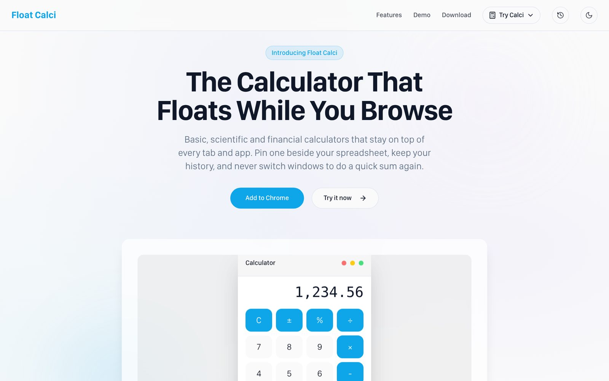
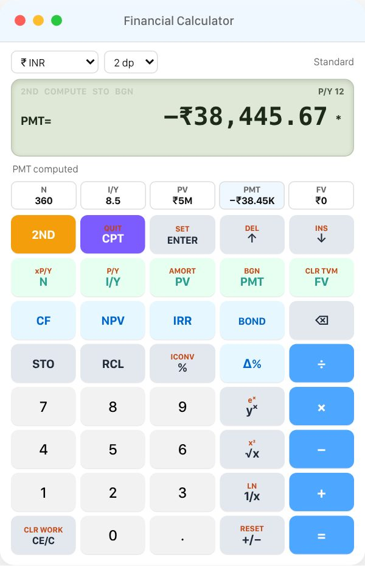
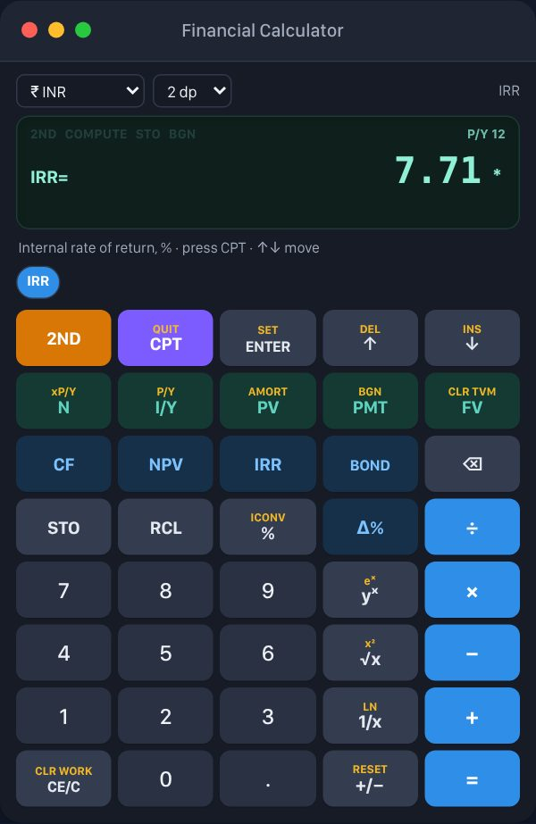
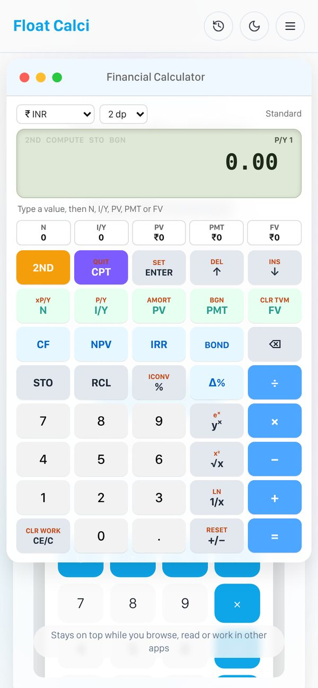
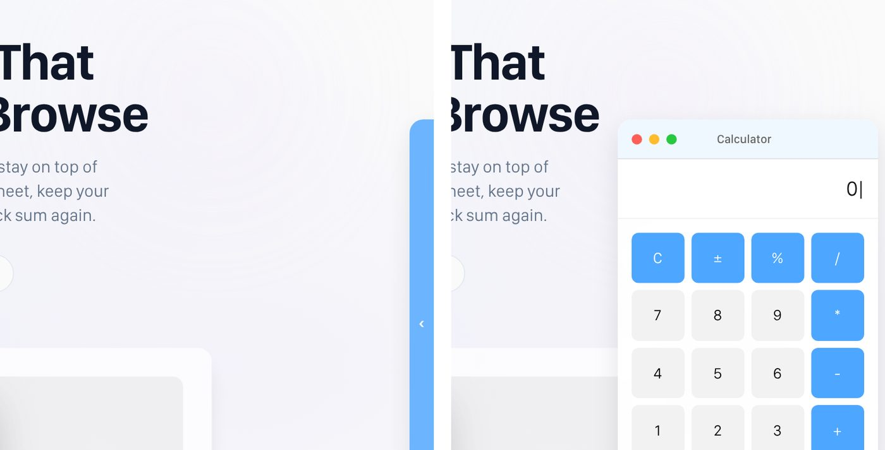
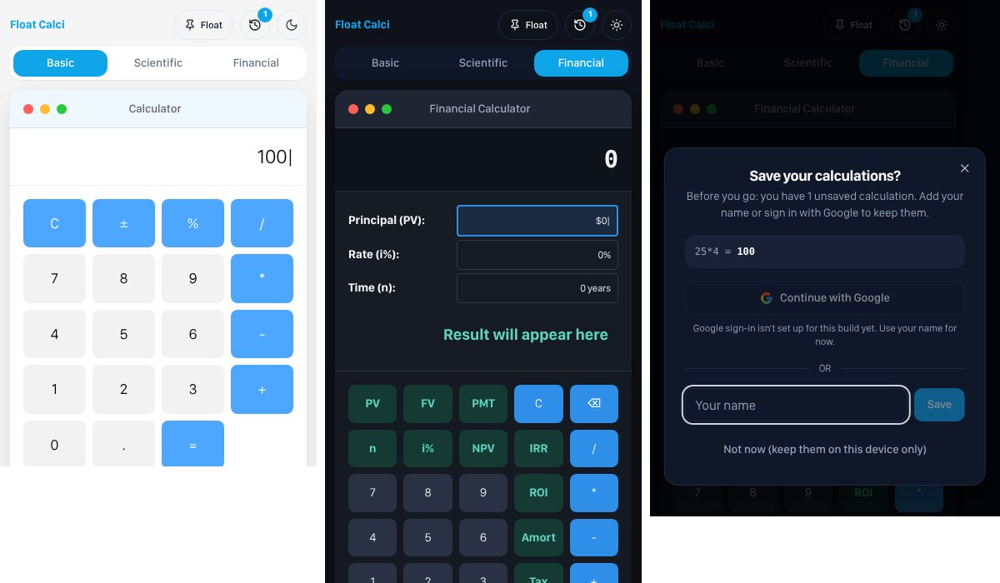

# 🧮 Float Calci

**The calculator that floats while you browse.** Basic, Scientific and Financial calculators that you can drag around a page, tuck into the edge of the screen, use in dark mode, keep a history of, and **pin on top of every app on your laptop**. Available as a website and as a Chrome extension (Manifest V3).



## ✨ Features

- **Float on top of all apps, straight from the website**: one click on **Float it over everything** keeps the calculator above every tab and app (Excel, PDFs, Zoom…) with no install (Chrome / Edge 116+ on a computer)
- **Installable app**: install Float Calci from the site; it opens in its own window from your dock or start menu and works offline
- **See-through while scrolling**: the floating calculator fades to glass while the page scrolls, so you can read what's underneath
- **Magnetic edge tuck**: drag a calculator off the side of the page and it tucks in. After a 5-second pause, hover near the tab for 2 seconds (or click it) and it slides back out
- **Financial calculator with exam-calculator keystrokes**: TVM (N, I/Y, PV, PMT, FV, CPT, 2ND), cash flows, NPV, IRR, payback, amortization, bonds, interest conversion and percent change
- **11 currencies**: ₹, $, €, £, ¥, AED, S$, A$, C$, CHF, CN¥ (or none), with big amounts written out in millions and billions
- **Chrome extension**: click the icon and a calculator floats over the page you're on (drag, minimise, close, tuck), plus a floating window and keyboard shortcuts
- **Dark theme**: follows your system setting by default and remembers your choice
- **Calculation history**: every result is saved; closing a calculator asks for your name or *Continue with Google* to keep them
- **Works on phones**: a menu to open any calculator, sized to fit the screen
- **Safe maths**: no `eval()`; expressions go through a small parser (`src/lib/evaluate.ts`)
- **Tested**: 77 automated tests for the maths and the keystroke engine (`npm test`)

| Financial calculator | Dark mode (cash flow → IRR) | On a phone |
|---|---|---|
|  |  |  |

**Edge tuck**: tucked into the side, the tab filling while you hover, then sliding out



## 🚀 Getting Started

```bash
git clone https://github.com/Vinitintodia/Float-Calci.git
cd Float-Calci
npm install
npm run dev
```

Open http://localhost:8080 and choose a calculator from **Try Calci**, or try them in the **Live demo** section.

| Script | What it does |
|---|---|
| `npm run dev` | Start the dev server on port 8080 |
| `npm run build` | Build the website **and** the Chrome extension into `dist/` |
| `npm test` | Run the test suite (Vitest) |
| `npm run lint` | Run ESLint |
| `npm run preview` | Preview the production build |

## 🌍 Use it everywhere, no extension needed

From the website (e.g. `float-calci.vercel.app`):

| You want | Do this |
|---|---|
| A calculator above every tab and app, right now | Click **Float it over everything** (keep the Float Calci tab open; it can be in the background) |
| Float Calci as an app on your computer or phone | Click **Install app** (Chrome/Edge), or Safari → Share → **Add to Home Screen**. It opens in its own window, works offline, and **Pin** floats it over everything |
| The calculator *inside* other websites' pages | Only the [Chrome extension](#-chrome-extension) can do this: browsers don't let a website draw on other sites |

## 🌐 Deploy the website (Vercel)

The site is a static Vite build, so it runs free on Vercel's Hobby plan. `vercel.json` already has the settings.

1. Sign in at [vercel.com](https://vercel.com) with GitHub.
2. **Add New → Project**, pick this repository, and click **Deploy** (the defaults from `vercel.json` are right).
3. You get a URL like `https://float-calci.vercel.app`. Every push to `main` redeploys it automatically.

If you use Google sign-in, add `VITE_GOOGLE_CLIENT_ID` under **Project → Settings → Environment Variables**, and add the Vercel URL to **Authorized JavaScript origins** in Google Cloud Console.

## 🧩 Chrome Extension

1. `npm run build`
2. Open `chrome://extensions` and turn on **Developer mode**.
3. Click **Load unpacked** and select the `dist` folder.

| Action | How |
|---|---|
| Show / hide the calculator on the page | Toolbar icon or `Alt+Shift+C` |
| Move it | Drag the bar at the top |
| Close / minimise | Red / yellow dot |
| Tuck it into the edge | Drag it past the side of the page |
| Open the floating window | Green dot, or `Alt+Shift+F` |
| Keep it above all apps | **Pin** (or the green dot) in the floating window |



Full guide (how floating over other apps works, Google sign-in, permissions, publishing): [CHROME_EXTENSION_GUIDE.md](CHROME_EXTENSION_GUIDE.md)

## 💰 Financial Calculator

It follows the keystroke workflow taught for finance exams, so what you practise here carries over to a handheld financial calculator.

**Sign convention:** money you receive is positive, money you pay is negative (a loan: `PV = +5,000,000`, `PMT` comes out negative).

### Time value of money

| Key | Meaning |
|---|---|
| `N` | Number of payments |
| `I/Y` | Annual interest rate, % |
| `PV` / `PMT` / `FV` | Present value, payment per period, future value |
| `CPT` | Compute: press it, then the key you want solved |
| `2ND` `I/Y` (P/Y) | Payments per year (also sets compounding per year, C/Y) |
| `2ND` `PMT` (BGN) | Payments at the end (END) or beginning (BGN) of each period |
| `2ND` `N` (xP/Y) | Multiply the display by P/Y (30 years → 360 months) |
| `2ND` `FV` (CLR TVM) | Clear the five TVM values |

**Example: EMI on a ₹50 lakh home loan, 8.5% for 30 years**

```
2ND I/Y  12 ENTER  2ND CPT      (P/Y = 12, back to the calculator)
360 N   8.5 I/Y   5000000 PV   0 FV
CPT PMT                          → PMT = −₹38,445.67
```

### Worksheets

Open a worksheet, move with `↑` `↓`, type a value and press `ENTER`, or press `CPT` to compute. `2ND CPT` (QUIT) goes back to the standard calculator. The chips under the display jump straight to any variable.

| Worksheet | Open with | Variables |
|---|---|---|
| Cash flows | `CF` | CF0, C01/F01, C02/F02 … (`2ND ↑` deletes, `2ND ↓` inserts a flow) |
| NPV | `NPV` | I (rate) → NPV, NFV, PB (payback), DPB (discounted payback) |
| IRR | `IRR` | IRR (press `CPT`) |
| Amortization | `2ND PV` | P1, P2 → BAL, PRN, INT |
| Bond | `BOND` | RV, CPN, YRS, FREQ (`2ND ENTER` switches 2/Y and 1/Y) → YLD ⇄ PRI, DUR, MDUR |
| Interest conversion | `2ND %` | NOM ⇄ EFF, C/Y |
| Percent change | `Δ%` | OLD, NEW, %CH, #PD (solve any one) |

**Example: NPV and IRR of a project**

```
CF  1000000 +/- ENTER  ↓  300000 ENTER  ↓  4 ENTER    (−10 lakh, then 3 lakh for 4 years)
NPV  10 ENTER  ↓  CPT                                  → NPV at 10%
IRR  CPT                                               → IRR = 7.71%
```

The standard calculator chains left to right (`2 + 3 × 4 = 20`), and has `%`, `yˣ`, `√x`, `x²`, `1/x`, `LN`, `eˣ`, `STO`/`RCL` 0–9 memories, and `2ND +/-` (RESET, asks first). Your values are kept between sessions, like a real calculator's memory.

The bond worksheet works in whole coupon periods (years to maturity), not settlement dates.

## 🔢 Basic & Scientific

**Basic**: arithmetic, percent, plus/minus, decimals and backspace. After `=`, typing a number starts a new calculation, while an operator carries on from the result.

**Scientific**: `sin` `cos` `tan` (degrees), `log`, `ln`, `√`, powers (`^`, `x²`, `x³`), brackets, `π`, `e`, `EXP` (`1.5 EXP 3` = 1500), `×10^`, and `Ans` (the last answer). Implicit multiplication such as `2π` or `3(4+1)` works, and missing closing brackets are added for you.

## ⌨️ Keyboard Shortcuts

| Calculator | Keys |
|---|---|
| Basic | `0–9` `+ - * / . %` · `Enter` = · `Backspace` delete · `Esc` clear |
| Scientific | `0–9` `+ - * / ^ ( )` · `s` sin · `c` cos · `t` tan · `l` log · `r` √ · `p` π · `Space` close bracket · `Backspace` delete · `Esc` clear · `Enter` = |
| Financial | `0–9` `.` `+ - * / ^ %` · `n` N · `i` I/Y · `p` PV · `m` PMT · `f` FV · `c` CPT · `s` 2ND · `↑ ↓` move · `Enter` ENTER (or = outside a worksheet) · `Backspace` delete · `Esc` CE/C |

On the landing page, the demo calculators only take the keyboard after you click them, so arrow keys still scroll the page.

## 💾 History & Sign-in

- Results are stored on your device: `localStorage` on the website, `chrome.storage.local` in the extension.
- When you close a calculator with unsaved calculations, you can save them under your **name** or with **Google**. After that, new results save to your profile automatically.
- Signing out keeps your saved calculations on the device; they come back when you sign in again. **Sign out & delete my data** removes them.
- A name profile has no password: anyone using the same browser can open it. On a shared computer, delete your data when you're done or use your own Chrome profile. See [SECURITY.md](SECURITY.md).

**Enabling Google sign-in** (optional): create an OAuth Client ID in Google Cloud Console, then copy `.env.example` to `.env` and set:

```
VITE_GOOGLE_CLIENT_ID=your-client-id.apps.googleusercontent.com
```

The step-by-step setup is in the [extension guide](CHROME_EXTENSION_GUIDE.md#setting-up-continue-with-google). Without a client ID, saving by name still works.

## 🛠️ Tech Stack

React 18 · TypeScript · Vite · Tailwind CSS · shadcn/ui (Radix) · Lucide icons · Vitest · Chrome Extension Manifest V3 · Document Picture-in-Picture API · Google Identity Services

## 📁 Project Structure

```
src/
├── components/
│   ├── calculator/
│   │   ├── CalculatorShell.tsx   # shared window: drag, edge tuck, keyboard, float-on-top
│   │   └── CalculatorHost.tsx    # floating (website) vs docked (demo, extension)
│   ├── FloatingCalculator.tsx    # Basic
│   ├── ScientificCalculator.tsx
│   ├── FinancialCalculator.tsx   # financial keypad, display and currency picker
│   ├── AppDemo.tsx               # live demo on the landing page
│   ├── HistoryPanel.tsx
│   ├── SaveCalculationsDialog.tsx
│   └── ThemeToggle.tsx
├── lib/
│   ├── finance.ts                # TVM, NPV, IRR, amortization, bonds… (pure maths)
│   ├── finCalc.ts                # financial keystroke engine (2ND, CPT, worksheets)
│   ├── currency.ts               # currencies and number formatting
│   ├── evaluate.ts               # safe expression parser
│   ├── history.ts                # history + profile store
│   ├── storage.ts                # chrome.storage / localStorage
│   ├── theme.ts                  # light / dark / system
│   ├── googleAuth.ts             # Google sign-in (web + extension)
│   └── *.test.ts                 # tests
├── extension/
│   ├── background.ts             # extension service worker (icon click, floating window)
│   └── overlay.ts                # the calculator drawn over a web page
├── pages/Index.tsx               # website
└── popup.tsx                     # extension calculator (on-page frame + floating window)
public/manifest.json              # Manifest V3
```

## 🗺️ Roadmap

- Sync history across devices (Firebase or Supabase, keyed by Google account)
- Live currency conversion when you switch currency
- Date-based bond pricing (settlement and maturity dates), depreciation and statistics worksheets
- Publish to the Chrome Web Store
- Desktop app (Tauri) so it can float even with Chrome closed

## 🔒 Security & privacy

No server, no accounts on a server: everything is stored in your browser on your device. The extension has no
host permissions and only runs on a tab when you click it; the website ships with a strict Content Security
Policy. Details, limitations and how to report a problem: [SECURITY.md](SECURITY.md).

## 🤝 Contributing

Read the [developer guide](docs/DEVELOPER.md) (architecture, the financial engine, the extension, testing and
releasing). Run `npm test` and `npm run lint` before opening a pull request. For bigger changes, please open an
issue first.
