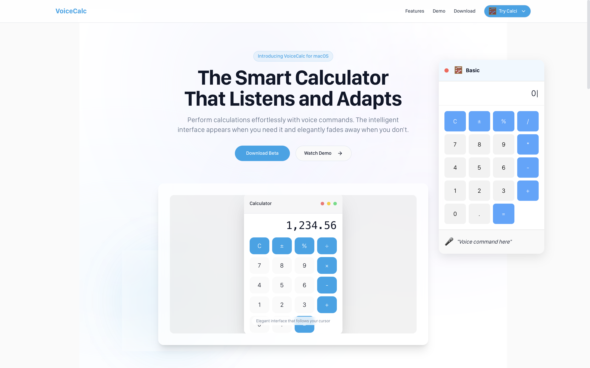
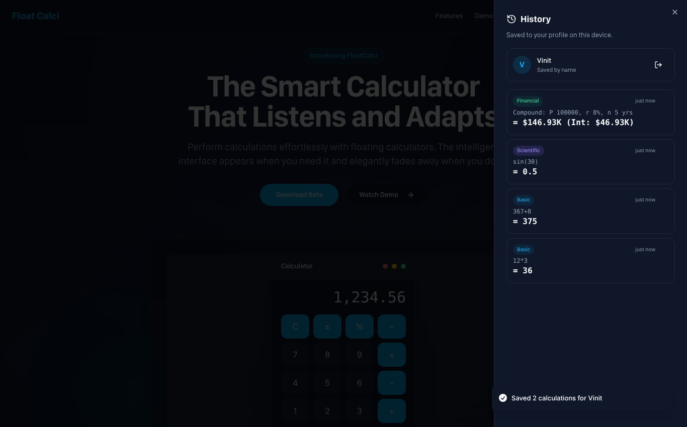

# 🧮 Float Calci

Floating Basic, Scientific and Financial calculators that you can drag around a page, use in dark mode, keep a history of, and **pin on top of every app on your laptop**. Available as a website and as a Chrome extension (Manifest V3).



## ✨ Features

- **Three calculators**: Basic, Scientific and Financial (compound interest)
- **Float on top of all apps**: the green window dot pins the calculator above Excel, PDFs, Zoom and everything else (Chrome / Edge 116+ on desktop)
- **Chrome extension**: toolbar popup, a floating window, and keyboard shortcuts
- **Dark theme**: light/dark toggle that follows your system setting by default and remembers your choice
- **Calculation history**: every result is saved instantly; view, copy or delete it from the History panel
- **Save prompt on close**: closing a calculator with unsaved work asks for your name or *Continue with Google*
- **Draggable and minimisable**: macOS-style window controls; fades slightly when you're not using it
- **Full keyboard support** for all three calculators
- **Safe evaluation**: no `eval()`; expressions go through a small parser (`src/lib/evaluate.ts`)

| Dark mode | History |
|---|---|
|  |  |

**Chrome extension:** popup, dark mode, and the save prompt


## 🚀 Getting Started

```bash
git clone https://github.com/Vinitintodia/voice-calc-vision.git
cd voice-calc-vision
npm install
npm run dev
```

Open http://localhost:8080 and choose a calculator from **Try Calci**.

| Script | What it does |
|---|---|
| `npm run dev` | Start the dev server on port 8080 |
| `npm run build` | Build the website **and** the Chrome extension into `dist/` |
| `npm run preview` | Preview the production build |
| `npm run lint` | Run ESLint |

## 🧩 Chrome Extension

1. `npm run build`
2. Open `chrome://extensions` and turn on **Developer mode**.
3. Click **Load unpacked** and select the `dist` folder.

| Action | How |
|---|---|
| Open the popup | Toolbar icon or `Alt+Shift+C` |
| Open the floating window | **Float** button in the popup or `Alt+Shift+F` |
| Keep it above all apps | **Pin on top** (or the green dot) in the floating window |

The full guide covers how floating over other apps works, permissions and publishing:
[CHROME_EXTENSION_GUIDE.md](CHROME_EXTENSION_GUIDE.md)

## 💾 History & Sign-in

- Results are stored on your device: `localStorage` on the website, `chrome.storage.local` in the extension.
- When you close a calculator with unsaved calculations, you can save them under your **name** or with **Google**. After that, new results save to your profile automatically.
- Signing out keeps your saved calculations on the device; they come back when you sign in again.

**Enabling Google sign-in** (optional): create an OAuth Client ID in Google Cloud Console, then copy `.env.example` to `.env` and set:

```
VITE_GOOGLE_CLIENT_ID=your-client-id.apps.googleusercontent.com
```

The step-by-step setup is in the [extension guide](CHROME_EXTENSION_GUIDE.md#setting-up-continue-with-google). Without a client ID, saving by name still works.

## 🔢 Calculators

### Basic
Arithmetic (`+ − × ÷`), percent, plus/minus, decimals.

### Scientific
`sin` `cos` `tan` (in degrees), `log` (base 10), `ln`, `√`, powers (`^`, `x²`, `x³`), brackets, and the constants `π` and `e`.
Implicit multiplication such as `2π` or `3(4+1)` works, and missing closing brackets are added for you (`sin(30` → `0.5`). Undefined results such as `tan(90)` show **Error**.

### Financial
Compound interest, `A = P(1 + r)ⁿ`: enter Principal, Rate (%) and Time (years) to get the final amount and the interest earned.

## ⌨️ Keyboard Shortcuts

| Calculator | Keys |
|---|---|
| Basic | `0–9` `+ - * / . %` · `Enter` = · `Esc` / `Backspace` clear |
| Scientific | `0–9` `+ - * / ^ ( )` · `s` sin · `c` cos · `t` tan · `l` log · `r` √ · `p` π · `Space` close bracket · `Backspace` delete · `Esc` clear · `Enter` = |
| Financial | `0–9` `.` · `Tab` / arrow keys switch field · `Enter` calculate · `Backspace` delete · `Esc` / `C` clear field |

## 🛠️ Tech Stack

React 18 · TypeScript · Vite · Tailwind CSS · shadcn/ui (Radix) · Lucide icons · Chrome Extension Manifest V3 · Document Picture-in-Picture API · Google Identity Services

## 📁 Project Structure

```
src/
├── components/
│   ├── calculator/
│   │   ├── CalculatorShell.tsx   # shared window: drag, minimise, keyboard, float-on-top
│   │   └── CalculatorHost.tsx    # floating (website) vs docked (extension) behaviour
│   ├── FloatingCalculator.tsx    # Basic
│   ├── ScientificCalculator.tsx
│   ├── FinancialCalculator.tsx
│   ├── HistoryPanel.tsx
│   ├── SaveCalculationsDialog.tsx
│   └── ThemeToggle.tsx
├── lib/
│   ├── evaluate.ts               # safe expression parser
│   ├── history.ts                # history + profile store
│   ├── storage.ts                # chrome.storage / localStorage
│   ├── theme.ts                  # light / dark / system
│   └── googleAuth.ts             # Google sign-in (web + extension)
├── extension/background.ts       # extension service worker
├── pages/Index.tsx               # website
└── popup.tsx                     # extension popup + floating window
public/manifest.json              # Manifest V3
```

## 🗺️ Roadmap

- Sync history across devices (Firebase or Supabase, keyed by Google account)
- Wire up the remaining financial keys: NPV, IRR, PMT, FV, amortisation
- `Ans` and `EXP` keys on the scientific calculator
- Desktop app (Tauri/Electron) so it can float even with Chrome closed

## 🤝 Contributing

Pull requests are welcome. For bigger changes, please open an issue first to discuss what you'd like to change.
